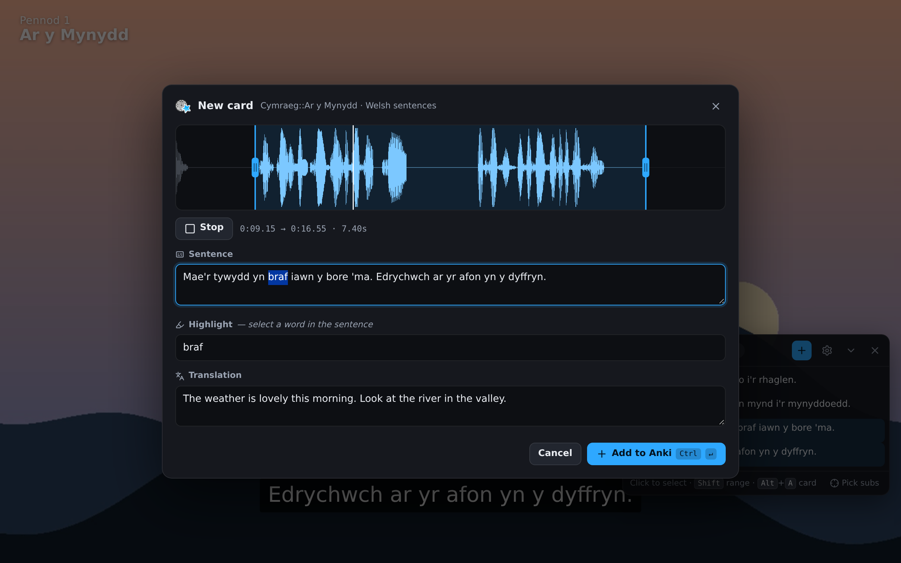
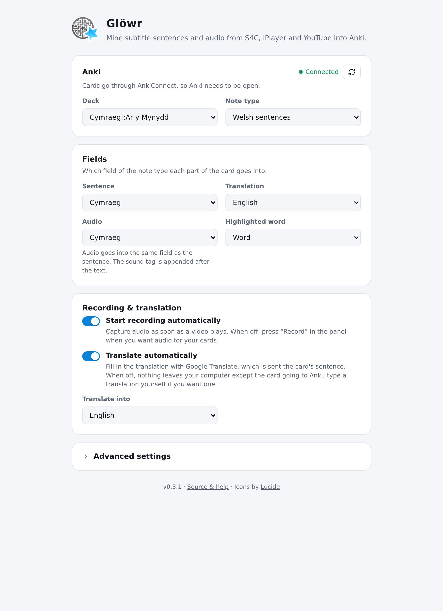
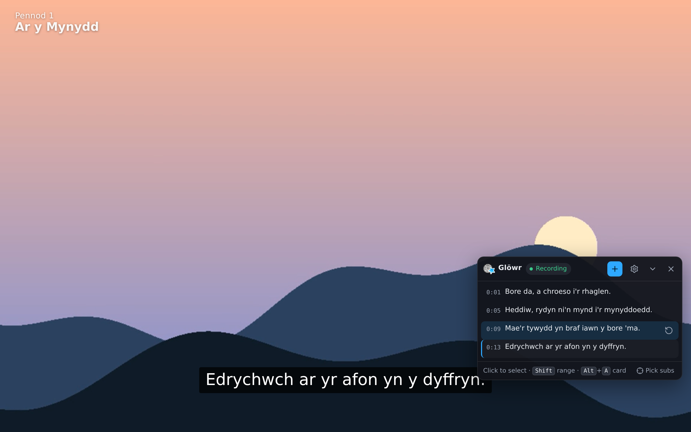

<p align="center">
  
</p>

<h1 align="center">Glöwr</h1>

<p align="center">
  <b>Turn what you watch into Anki flashcards, with the audio.</b><br>
  Works on S4C Clic, BBC iPlayer and YouTube, in Firefox and Chrome.
</p>

<p align="center">
  <a href="https://gitbugr.github.io/glowr/">Website</a> ·
  <a href="https://chromewebstore.google.com/detail/dfjjookphonpefomjppbhpfohhhljmki">Chrome</a> ·
  <a href="https://addons.mozilla.org/firefox/addon/gl%C3%B6wr/">Firefox</a> ·
  <a href="#for-developers">For developers</a>
</p>

<p align="center">
  
</p>

## What it does

You're watching something with subtitles. You hear a sentence you want to learn.

Press <kbd>Alt</kbd>+<kbd>A</kbd>. You get a flashcard with:

- 🔊 **the audio** of that line
- 💬 **the sentence**
- 🌍 **a translation**
- ✏️ **a word you pick**, in bold

Press <kbd>Ctrl</kbd>+<kbd>Enter</kbd> and it's in Anki. That's it.

*Glöwr* is Welsh for a coal miner. It was made for learning Welsh, but works for
any language with subtitles.

## What you need

1. **[Anki](https://apps.ankiweb.net/)**, the free flashcard app.
2. **[AnkiConnect](https://ankiweb.net/shared/info/2055492159)**, an Anki add-on that lets Glöwr send cards to Anki.
3. **Firefox** (version 149 or newer) **or Chrome** (or Edge, Brave, etc.).

## Set it up

**1. Install AnkiConnect**

- Open Anki.
- Go to **Tools → Add-ons → Get Add-ons…**
- Paste this code: `2055492159`
- Restart Anki.

**2. Install Glöwr**

- **Chrome** (or Edge, Brave): [get it from the Chrome Web Store](https://chromewebstore.google.com/detail/dfjjookphonpefomjppbhpfohhhljmki).
- **Firefox:** [get it from Firefox Add-ons](https://addons.mozilla.org/firefox/addon/gl%C3%B6wr/).
- Click **Add**, then confirm.

**3. Connect it to Anki**

- Make sure Anki is open.
- Click Glöwr's icon in your browser toolbar. Settings open.
- Anki pops up asking to allow Glöwr. **Click Yes.**
- Pick your **deck**, **note type**, and which **field** gets what.

<p align="center">
  
</p>

## Make a card

1. Play a programme. **Turn subtitles on** in the video player.
2. A small panel appears, listing lines as they're spoken.
3. Hear a good one? Press <kbd>Alt</kbd>+<kbd>A</kbd> (<kbd>Option</kbd>+<kbd>A</kbd> on a Mac).
4. Check the card. Press <kbd>Ctrl</kbd>+<kbd>Enter</kbd> to save.

<p align="center">
  
</p>

### Handy extras

| Want to… | Do this |
| --- | --- |
| Use an older line | Click it in the panel, then <kbd>Alt</kbd>+<kbd>A</kbd> |
| Use several lines | Click the first, <kbd>Shift</kbd>-click the last |
| Hear a line again | Hover it and click ↺ |
| Bold a word | Double-click it in the card editor |
| Trim the audio | Drag the blue handles. <kbd>Space</kbd> plays it |
| Cancel a card | <kbd>Esc</kbd> |
| Hide the panel | Click **×**. Click Glöwr's toolbar icon to bring it back |

## Something not working?

- **"Click page to record"?** Click anywhere on the page once. Browsers need this before they allow audio recording.
- **No audio on the card?** Glöwr only has audio for lines you've played, at normal speed (not 1.5×).
- **No lines in the panel?** Check subtitles are on. If they are, click **Pick subs** in the panel, then click the subtitles on the video.
- **"Can't reach Anki"?** Open Anki. Check AnkiConnect is installed. Then click ↻ in Settings.

## Settings worth knowing

- **Start recording automatically.** On by default. Turn it off to only record when you press **Record**.
- **Translate automatically.** On by default. Turn it off to write translations yourself.
- **Advanced settings** (at the bottom). Change AnkiConnect's address or API key, the translation service, audio padding and subtitle sources. There's a button to reset them all.

## Privacy

Glöwr has no server and collects nothing.

- The sentence goes to **Google Translate** for the translation. You can turn this off.
- The card goes to **Anki**, on your own computer.

Recorded audio stays in your browser tab and is thrown away when you leave the page.

## Legal notice & copyright

This tool is intended for personal language learning and private study. Users are responsible for ensuring that their use of recorded audio and subtitle excerpts complies with applicable copyright laws and the terms of the streaming services they use.

Only record short excerpts for personal educational use. Do not redistribute, publish, or share copyrighted audio recordings or subtitle content.

In the UK, a TV Licence is needed to watch anything on BBC iPlayer, and to watch any channel live, including S4C's live stream on Clic. S4C's on-demand programmes don't need one. You are responsible for ensuring that you hold any licence required for your viewing activities.

This software is provided as-is and does not grant permission to copy or distribute copyrighted material.

Glöwr isn't affiliated with S4C, the BBC, Google or Anki.

---

## For developers

### How it works

- **Reading subtitles.** Each site has a CSS selector for its on-screen subtitles, polled 10 times a second; native `TextTrack` cues are used too when a player exposes them. iPlayer's player is built from web components, so the search descends into shadow roots. `CaptionTracker` turns the changing text into timed lines, including YouTube's rolling captions (`src/content/cues.ts`).
- **Recording audio** uses `HTMLMediaElement.captureStream()`, which listens to the video without changing how the page plays it (`src/content/recorder.ts`).
- **Placing audio in time.** Audio arrives in small blocks at uneven intervals. Blocks from uninterrupted playback are stored back to back as a *run*, positioned on the video's timeline from all of their timestamps. Where runs overlap, the newer recording wins (`src/content/audio-store.ts`).
- **The panel** lives in a closed shadow root so the site's CSS can't affect it, moves into the fullscreen element when the player goes fullscreen, and creates all its HTML through a Trusted Types policy for YouTube.
- **Network access.** AnkiConnect (`127.0.0.1:8765`) and Google Translate are granted at install. Other addresses set in Advanced settings are requested as optional host permissions when the user saves them.

| Site | Default subtitle selector |
| --- | --- |
| S4C Clic | `.vjs-text-track-cue` |
| BBC iPlayer | `smp-subtitles` (inside its shadow DOM) |
| YouTube | `.ytp-caption-segment` (watch pages, embeds and live) |

### Building

Requires **Node 22+**.

```sh
git clone https://github.com/gitbugr/glowr.git
cd glowr
npm install
npm run build          # dist/firefox and dist/chrome
```

Load `dist/chrome` with *Load unpacked*, or `dist/firefox/manifest.json` as a temporary add-on.

```sh
npm run dev:firefox    # rebuilds dist/firefox on change
npm run start:firefox  # in another terminal: Firefox with the extension, reloading on change
npm run dev:chrome     # same for Chromium (start:chrome to launch it)
```

| Command | Does |
| --- | --- |
| `npm run build` | Build both browsers into `dist/` |
| `npm run typecheck` | TypeScript, no output |
| `npm test` | Unit tests (Vitest) for caption tracking, the audio store and text helpers |
| `npm run lint` | Mozilla's add-on linter on the Firefox build |
| `npm run check` | All of the above |
| `npm run package` | Store-ready zips (and a source zip for AMO review) in `web-ext-artifacts/` |
| `npm run screenshots` | End-to-end run in Chromium that also regenerates `docs/screenshots/`, including 1280×800 store screenshots in `store/` (see below) |
| `npm run icons` | Regenerate the PNG icons from `public/icons/icon.svg` |
| `npm run promo` | Render the 440×280 promo tile and 1400×560 marquee into `docs/screenshots/store/` |

```
src/
  background/   AnkiConnect and translation requests, toolbar button
  content/      everything on the video page
    cues.ts         timed lines and the caption tracker (pure, tested)
    audio-store.ts  recorded audio indexed by media time (pure, tested)
    recorder.ts     audio capture
    dom.ts          shadow-DOM-aware queries, subtitle text, element picker selectors
    ui/             panel, card editor, subtitle picker, styles
  options/      settings page
  shared/       site profiles and defaults (config.ts), messages, icons
scripts/        build, manifests, packaging, screenshots
public/         icons copied into the build
docs/           the GitHub Pages site and screenshots
```

**Adding a site** is mostly a new entry in `SITES` and `MATCHES` in
`src/shared/config.ts`: hostnames, a subtitle selector, and optionally which
paths to run on, how to spot ads and how to tell programmes apart.

**Screenshots and end-to-end test.** `npm run screenshots` generates a short demo
programme (an animated landscape with Welsh lines spoken by espeak-ng), serves it
locally under S4C's hostname so the real build activates, fakes AnkiConnect and
Google Translate, then drives Chromium through watching, making a two-line card,
closing and reopening the panel, and the settings page including Advanced settings.
It checks each step along the way. Needs `ffmpeg`, `espeak-ng`, `openssl` and
`npx playwright install chromium`; close Anki first, since it uses AnkiConnect's port.

**Lint warnings.** `npm run lint` reports a few warnings, which are expected: the
panel's HTML is set with `innerHTML` from fixed templates (user text is escaped);
`chrome.dom` is a Chromium API that's checked for before use; and the linter
can't parse part of the vendored lamejs.

## Licence

[MIT](LICENSE). Bundled third-party code is listed in
[THIRD_PARTY_NOTICES.md](THIRD_PARTY_NOTICES.md); notably the MP3 encoder,
[lamejs](https://github.com/zhuker/lamejs), is LGPL-3.0 and ships as a separate,
unmodified file.
